# Phase 1 validation results

- Generated: `2026-10-21T23:48:19Z`
- OBS Studio: **32.2.2**; obs-websocket: **5.7.4** (RPC 1)
- Overall: **PASS**
- Bootstrap: **8 scenes**, **179 requests**, **0 failed**
- Camera: `Vidyst_Camera_Raw` (HP Wide Vision HD Camera)
- Screen: `Vidyst_Screen` (1920x1080 @ 0,0 (Primary Monitor))
- Mask: `Vidyst_Camera_Mask` (advanced_masks_filter), base 86.4; circle 540; tile 86.4
- Transition: `Move` at 350 ms
- Reports: [bootstrap](phase1-bootstrap.json), [rerun](phase1-bootstrap-rerun.json), [JSON](phase1-results.json)

## Bootstrap validation

**PASS** — Bootstrap created/reconciled all scenes and verified them live.

Notes:

- All vertical screen slots use OBS_BOUNDS_SCALE_INNER with cropToBounds=false.
- Main and vertical screenshots were captured for every layout.

Screenshots:

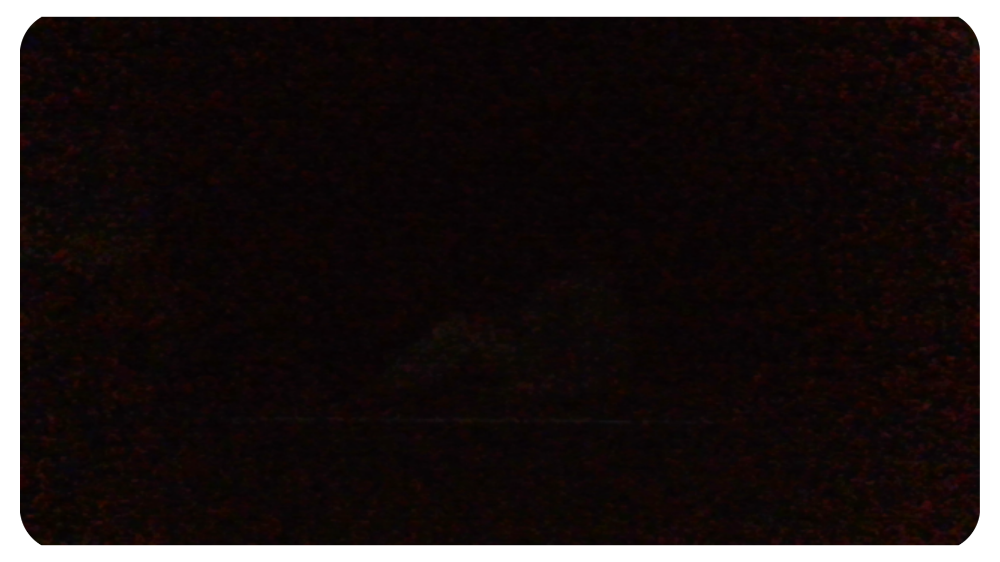
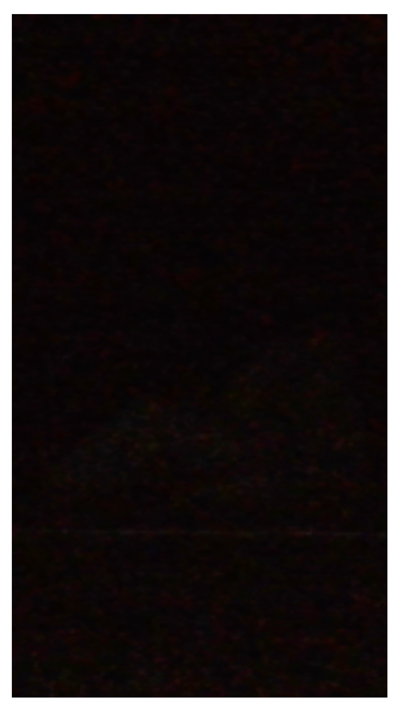
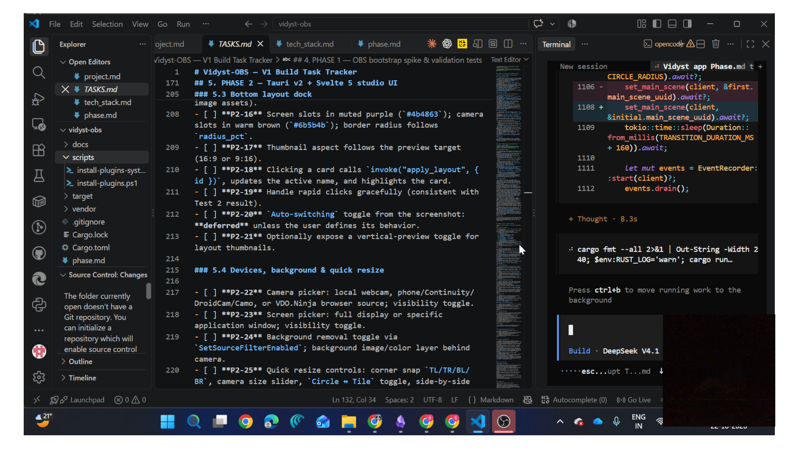
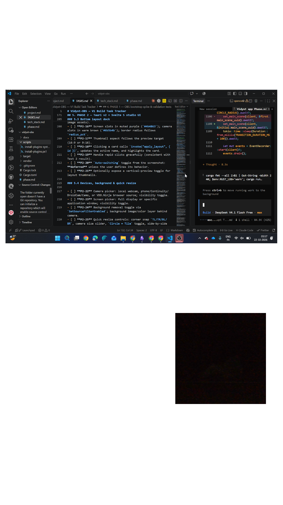
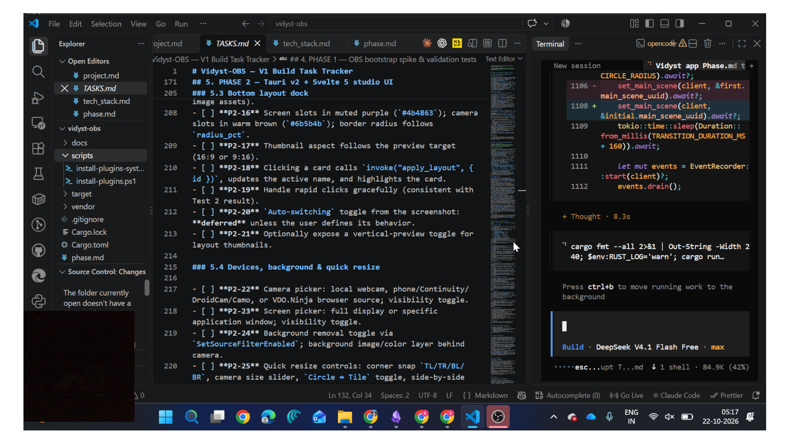
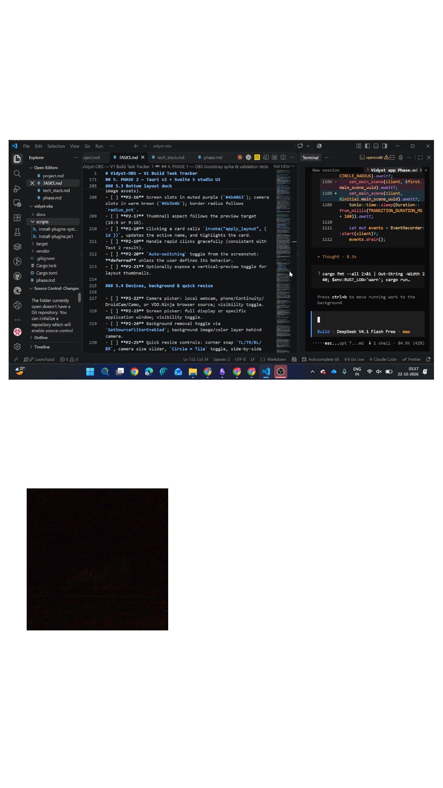
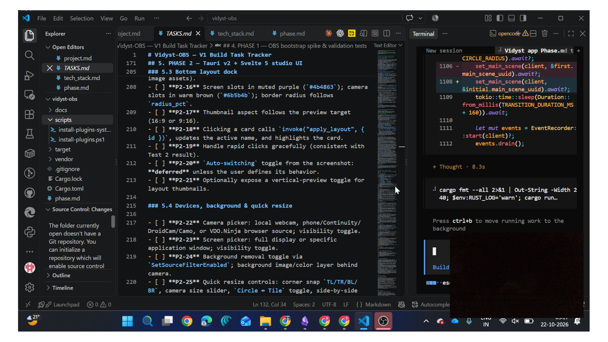

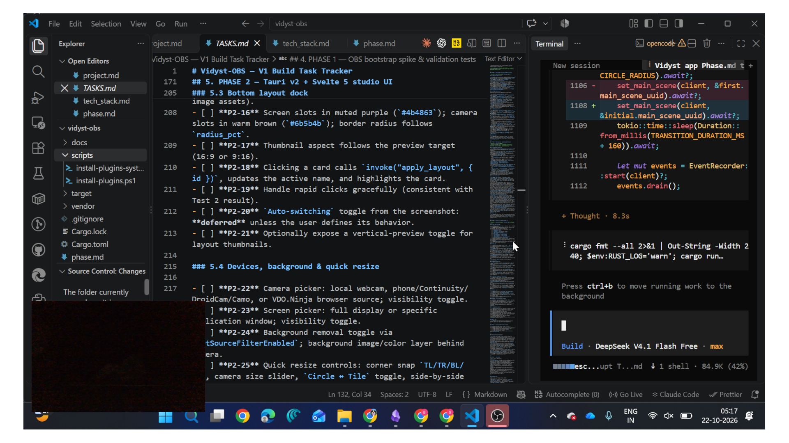
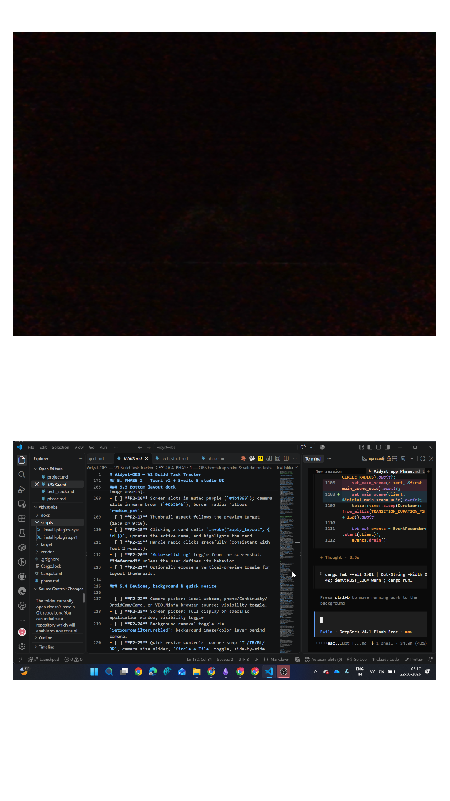
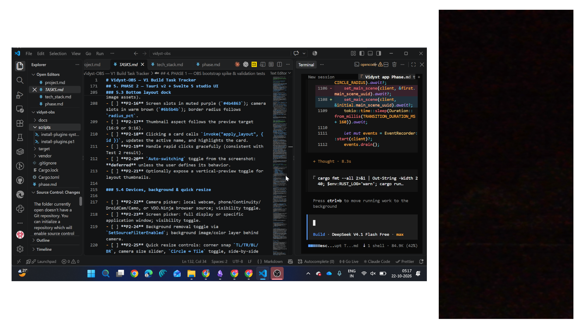
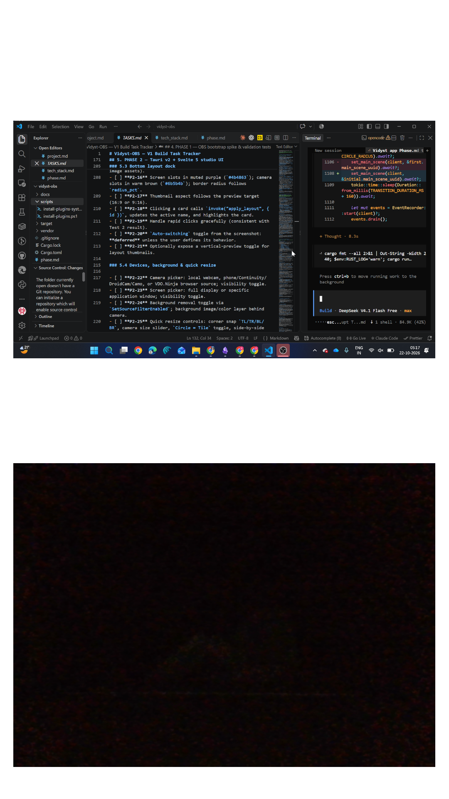
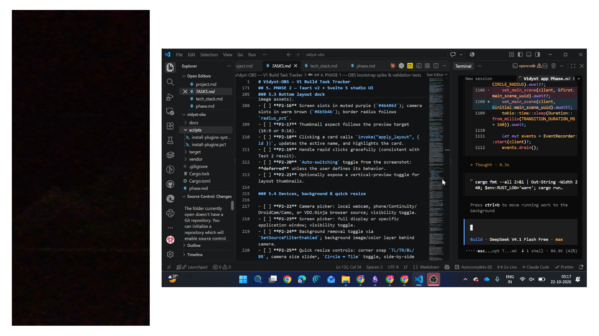
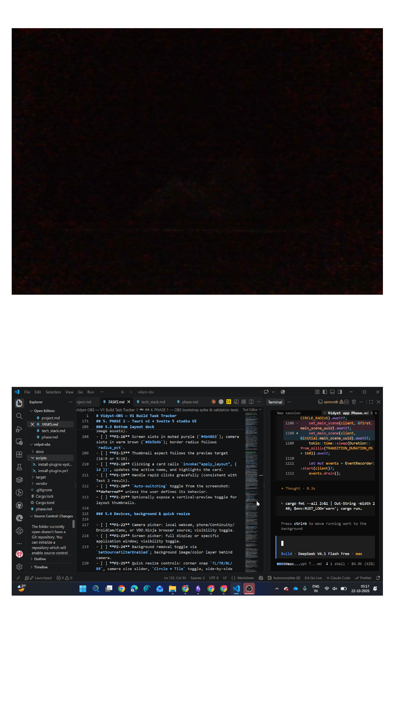

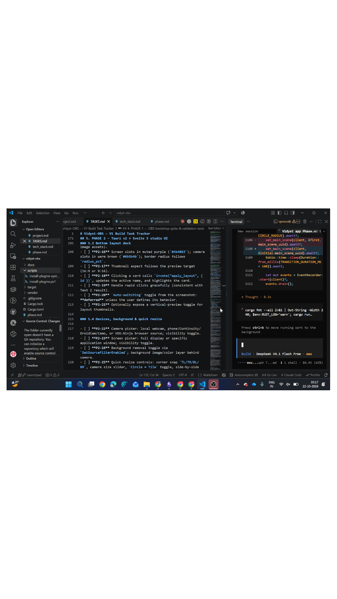

<details><summary>Evidence JSON</summary>

```json
{
  "checks": {
    "expected_scenes": 8,
    "image_count": 16,
    "main_scenes": [
      "Vidyst_Camera_Group",
      "Vidyst_just_me",
      "Vidyst_screen_cam",
      "Vidyst_screen_cam_inv",
      "Vidyst_screen_tile",
      "Vidyst_screen_tile_inv",
      "Vidyst_side_by_side",
      "Vidyst_side_by_side_inv",
      "Vidyst_screen_focus",
      "Scene"
    ],
    "mask_radius": 86.4,
    "request_failures": 0,
    "transition": "Move",
    "transition_duration_ms": 350,
    "vertical_scenes": [
      "Vertical Scene",
      "Vidyst_just_me",
      "Vidyst_screen_cam",
      "Vidyst_screen_cam_inv",
      "Vidyst_screen_tile",
      "Vidyst_screen_tile_inv",
      "Vidyst_side_by_side",
      "Vidyst_side_by_side_inv",
      "Vidyst_screen_focus"
    ],
    "vidyst_inputs": [
      "Vidyst_Camera_Raw",
      "Vidyst_Mic",
      "Vidyst_Screen",
      "Vidyst_Screen_Audio"
    ]
  },
  "images": [
    {
      "height": 1080,
      "label": "main/just_me",
      "path": "screenshots/phase1/main_just_me.png",
      "width": 1920
    },
    {
      "height": 1920,
      "label": "vertical/just_me",
      "path": "screenshots/phase1/vertical_just_me.png",
      "width": 1080
    },
    {
      "height": 1080,
      "label": "main/screen_cam",
      "path": "screenshots/phase1/main_screen_cam.png",
      "width": 1920
    },
    {
      "height": 1920,
      "label": "vertical/screen_cam",
      "path": "screenshots/phase1/vertical_screen_cam.png",
      "width": 1080
    },
    {
      "height": 1080,
      "label": "main/screen_cam_inv",
      "path": "screenshots/phase1/main_screen_cam_inv.png",
      "width": 1920
    },
    {
      "height": 1920,
      "label": "vertical/screen_cam_inv",
      "path": "screenshots/phase1/vertical_screen_cam_inv.png",
      "width": 1080
    },
    {
      "height": 1080,
      "label": "main/screen_tile",
      "path": "screenshots/phase1/main_screen_tile.png",
      "width": 1920
    },
    {
      "height": 1920,
      "label": "vertical/screen_tile",
      "path": "screenshots/phase1/vertical_screen_tile.png",
      "width": 1080
    },
    {
      "height": 1080,
      "label": "main/screen_tile_inv",
      "path": "screenshots/phase1/main_screen_tile_inv.png",
      "width": 1920
    },
    {
      "height": 1920,
      "label": "vertical/screen_tile_inv",
      "path": "screenshots/phase1/vertical_screen_tile_inv.png",
      "width": 1080
    },
    {
      "height": 1080,
      "label": "main/side_by_side",
      "path": "screenshots/phase1/main_side_by_side.png",
      "width": 1920
    },
    {
      "height": 1920,
      "label": "vertical/side_by_side",
      "path": "screenshots/phase1/vertical_side_by_side.png",
      "width": 1080
    },
    {
      "height": 1080,
      "label": "main/side_by_side_inv",
      "path": "screenshots/phase1/main_side_by_side_inv.png",
      "width": 1920
    },
    {
      "height": 1920,
      "label": "vertical/side_by_side_inv",
      "path": "screenshots/phase1/vertical_side_by_side_inv.png",
      "width": 1080
    },
    {
      "height": 1080,
      "label": "main/screen_focus",
      "path": "screenshots/phase1/main_screen_focus.png",
      "width": 1920
    },
    {
      "height": 1920,
      "label": "vertical/screen_focus",
      "path": "screenshots/phase1/vertical_screen_focus.png",
      "width": 1080
    }
  ]
}
```

</details>


## Tests

### Smooth circle <-> tile morph — PASS

screen_cam circle (540) -> side_by_side tile (86.4); 6 intermediate radius samples, settled in Some(328) ms.

Duration: **3089 ms**

Notes:

- Radius samples: 540 at t=0 ms to 86.4 after settling.

Screenshots:

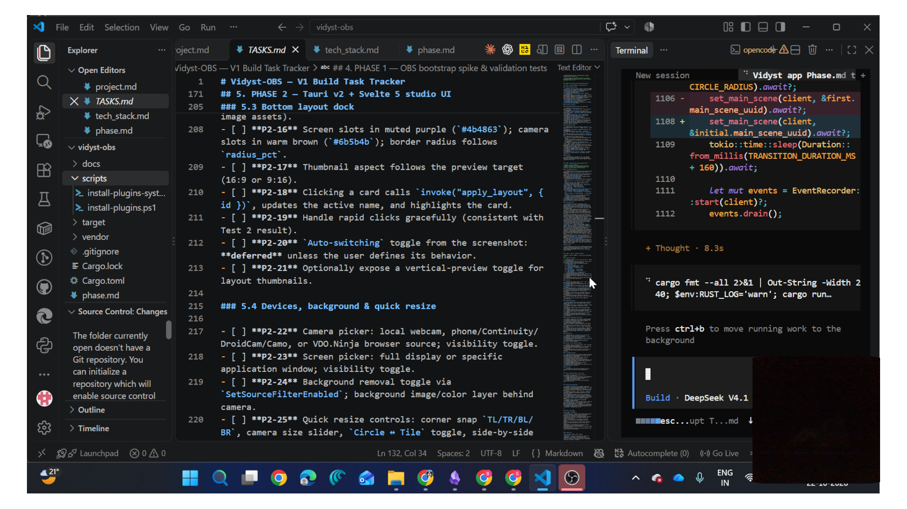
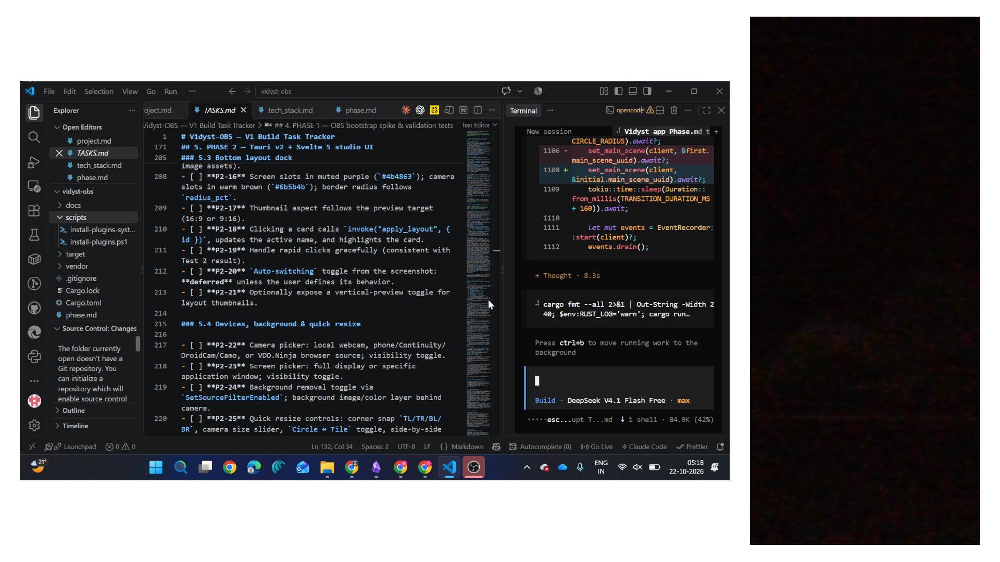

<details><summary>Evidence JSON</summary>

```json
{
  "events": [
    {
      "detail": "Move",
      "kind": "SceneTransitionStarted",
      "t_ms": 1
    },
    {
      "detail": "Move",
      "kind": "SceneTransitionVideoEnded",
      "t_ms": 366
    },
    {
      "detail": "Vidyst_side_by_side",
      "kind": "CurrentProgramSceneChanged",
      "t_ms": 366
    },
    {
      "detail": "Move",
      "kind": "SceneTransitionEnded",
      "t_ms": 417
    }
  ],
  "final_radius": 86.4,
  "from": "Vidyst_screen_cam",
  "samples": [
    {
      "radius": 540.0,
      "t_ms": 0
    },
    {
      "radius": 534.710205155611,
      "t_ms": 48
    },
    {
      "radius": 497.6816412448883,
      "t_ms": 95
    },
    {
      "radius": 397.17556285858154,
      "t_ms": 142
    },
    {
      "radius": 229.22454528808595,
      "t_ms": 190
    },
    {
      "radius": 128.7183857917786,
      "t_ms": 235
    },
    {
      "radius": 98.93879499435424,
      "t_ms": 282
    },
    {
      "radius": 86.59593472480775,
      "t_ms": 328
    },
    {
      "radius": 86.4,
      "t_ms": 377
    },
    {
      "radius": 86.4,
      "t_ms": 423
    },
    {
      "radius": 86.4,
      "t_ms": 470
    },
    {
      "radius": 86.4,
      "t_ms": 532
    },
    {
      "radius": 86.4,
      "t_ms": 579
    },
    {
      "radius": 86.4,
      "t_ms": 626
    },
    {
      "radius": 86.4,
      "t_ms": 673
    },
    {
      "radius": 86.4,
      "t_ms": 721
    }
  ],
  "settle_ms": 328,
  "start_radius": 540.0,
  "switch_command_ms": 26,
  "to": "Vidyst_side_by_side",
  "transition_event_span_ms": 416
}
```

</details>

### Rapid click test — PASS

5 layout switches issued on a 200 ms cadence in 926 ms; all commands succeeded and the final Move transition settled on Vidyst_screen_focus.

Duration: **2640 ms**

Notes:

- 5 scenes requested on a 200 ms cadence; all requests completed in 926 ms. 3 mid-flight radius sample(s) observed. Final scene Vidyst_screen_focus reached with radius 86.4.

Screenshots:

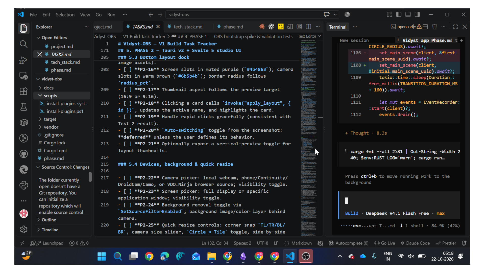

<details><summary>Evidence JSON</summary>

```json
{
  "events": [
    {
      "detail": "Move",
      "kind": "SceneTransitionStarted",
      "t_ms": 16
    },
    {
      "detail": "Move",
      "kind": "SceneTransitionEnded",
      "t_ms": 205
    },
    {
      "detail": "Move",
      "kind": "SceneTransitionStarted",
      "t_ms": 205
    },
    {
      "detail": "Move",
      "kind": "SceneTransitionEnded",
      "t_ms": 406
    },
    {
      "detail": "Move",
      "kind": "SceneTransitionStarted",
      "t_ms": 406
    },
    {
      "detail": "Move",
      "kind": "SceneTransitionEnded",
      "t_ms": 610
    },
    {
      "detail": "Move",
      "kind": "SceneTransitionStarted",
      "t_ms": 610
    },
    {
      "detail": "Move",
      "kind": "SceneTransitionEnded",
      "t_ms": 809
    },
    {
      "detail": "Move",
      "kind": "SceneTransitionStarted",
      "t_ms": 809
    },
    {
      "detail": "Move",
      "kind": "SceneTransitionVideoEnded",
      "t_ms": 1176
    },
    {
      "detail": "Vidyst_screen_focus",
      "kind": "CurrentProgramSceneChanged",
      "t_ms": 1176
    },
    {
      "detail": "Move",
      "kind": "SceneTransitionEnded",
      "t_ms": 1205
    }
  ],
  "final_radius": 86.4,
  "final_scene": "Vidyst_screen_focus",
  "midflight_samples": 3,
  "sequence": [
    "screen_cam",
    "side_by_side",
    "screen_tile",
    "just_me",
    "screen_focus"
  ],
  "sequence_elapsed_ms": 926,
  "steps": [
    {
      "command_ms": 34,
      "error": null,
      "index": 0,
      "observed_scene_immediately": "Vidyst_screen_cam",
      "ok": true,
      "radius_100ms": 540.0,
      "radius_after_trigger": 540.0,
      "scene": "Vidyst_screen_cam",
      "started_at_ms": 129
    },
    {
      "command_ms": 37,
      "error": null,
      "index": 1,
      "observed_scene_immediately": "Vidyst_side_by_side",
      "ok": true,
      "radius_100ms": 527.4612261280417,
      "radius_after_trigger": 540.0,
      "scene": "Vidyst_side_by_side",
      "started_at_ms": 313
    },
    {
      "command_ms": 34,
      "error": null,
      "index": 2,
      "observed_scene_immediately": "Vidyst_screen_tile",
      "ok": true,
      "radius_100ms": 276.90266175087316,
      "radius_after_trigger": 282.3183946609497,
      "scene": "Vidyst_screen_tile",
      "started_at_ms": 518
    },
    {
      "command_ms": 27,
      "error": null,
      "index": 3,
      "observed_scene_immediately": "Vidyst_just_me",
      "ok": true,
      "radius_100ms": 96.97761203550628,
      "radius_after_trigger": 171.02084957346483,
      "scene": "Vidyst_just_me",
      "started_at_ms": 721
    },
    {
      "command_ms": 28,
      "error": null,
      "index": 4,
      "observed_scene_immediately": "Vidyst_screen_focus",
      "ok": true,
      "radius_100ms": 86.4,
      "radius_after_trigger": 86.4,
      "scene": "Vidyst_screen_focus",
      "started_at_ms": 926
    }
  ],
  "transition_event_span_ms": 396,
  "transition_started_events": 5
}
```

</details>

### Audio mute and live listen toggles — PASS

Mic and screen audio mute toggles and MonitorAndOutput transitions verified, then restored.

Duration: **526 ms**

<details><summary>Evidence JSON</summary>

```json
{
  "inputs": [
    {
      "input": "Vidyst_Mic",
      "original": {
        "input": "Vidyst_Mic",
        "monitor": "OBS_MONITORING_TYPE_NONE",
        "muted": false
      },
      "steps": [
        {
          "action": "set_muted",
          "observed": true,
          "value": true
        },
        {
          "action": "set_muted",
          "observed": false,
          "value": false
        },
        {
          "action": "set_audio_monitor_type",
          "observed": "OBS_MONITORING_TYPE_MONITOR_AND_OUTPUT",
          "value": "OBS_MONITORING_TYPE_MONITOR_AND_OUTPUT"
        },
        {
          "action": "set_audio_monitor_type",
          "observed": "OBS_MONITORING_TYPE_NONE",
          "value": "OBS_MONITORING_TYPE_NONE"
        }
      ]
    },
    {
      "input": "Vidyst_Screen_Audio",
      "original": {
        "input": "Vidyst_Screen_Audio",
        "monitor": "OBS_MONITORING_TYPE_NONE",
        "muted": false
      },
      "steps": [
        {
          "action": "set_muted",
          "observed": true,
          "value": true
        },
        {
          "action": "set_muted",
          "observed": false,
          "value": false
        },
        {
          "action": "set_audio_monitor_type",
          "observed": "OBS_MONITORING_TYPE_MONITOR_AND_OUTPUT",
          "value": "OBS_MONITORING_TYPE_MONITOR_AND_OUTPUT"
        },
        {
          "action": "set_audio_monitor_type",
          "observed": "OBS_MONITORING_TYPE_NONE",
          "value": "OBS_MONITORING_TYPE_NONE"
        }
      ]
    }
  ]
}
```

</details>

### Vertical canvas sync through Aitum — PASS

Switched all 8 vertical scenes through the Aitum vendor request; each switch matched current_scene.

Duration: **11100 ms**

Notes:

- Aitum get_scenes lists every Vidyst vertical scene after the one-time restart.

Screenshots:

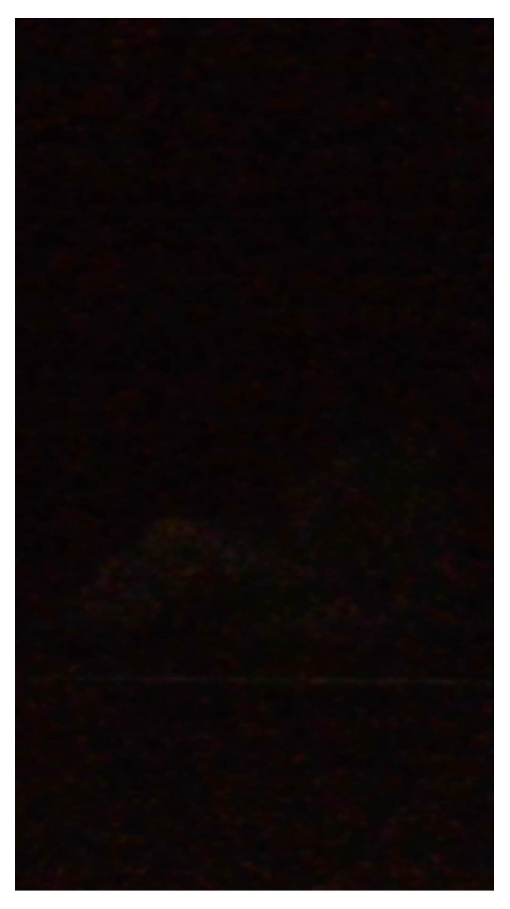
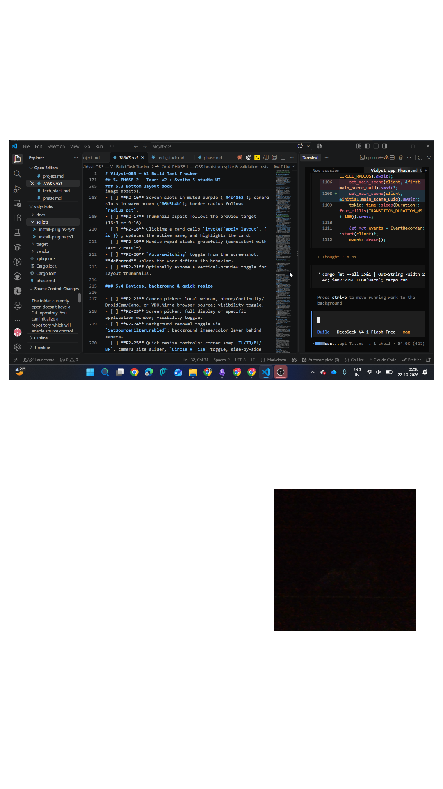
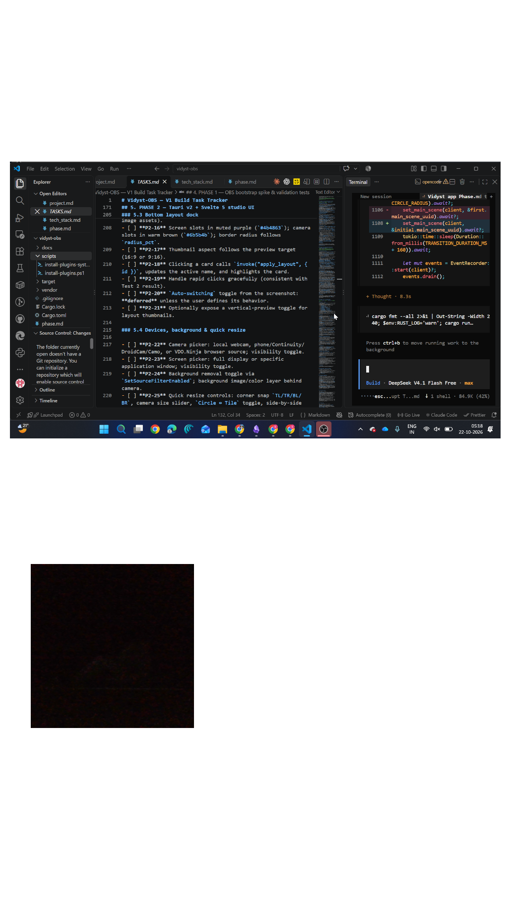
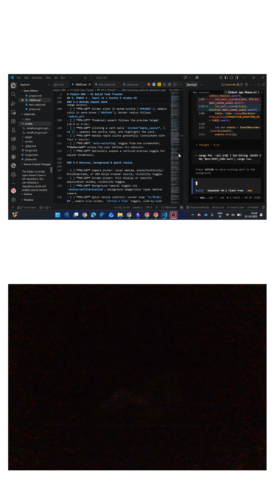
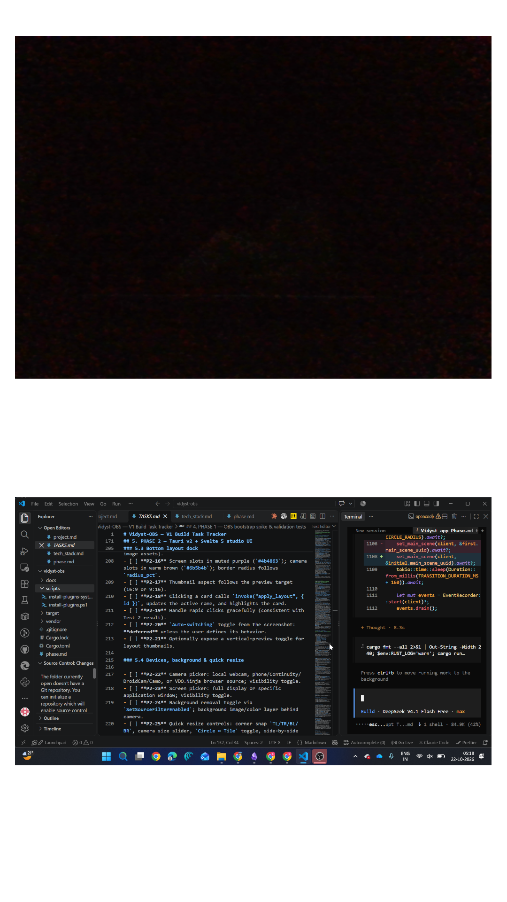


<details><summary>Evidence JSON</summary>

```json
{
  "after_current": {
    "scene": "Vidyst_screen_focus",
    "success": true
  },
  "after_scenes": {
    "scenes": [
      {
        "name": "Vidyst_screen_focus"
      },
      {
        "name": "Vidyst_side_by_side_inv"
      },
      {
        "name": "Vidyst_side_by_side"
      },
      {
        "name": "Vidyst_screen_tile_inv"
      },
      {
        "name": "Vidyst_screen_tile"
      },
      {
        "name": "Vidyst_screen_cam_inv"
      },
      {
        "name": "Vidyst_screen_cam"
      },
      {
        "name": "Vidyst_just_me"
      },
      {
        "name": "Vertical Scene"
      }
    ],
    "success": true
  },
  "before_current": {
    "scene": "Vidyst_screen_focus",
    "success": true
  },
  "before_scenes": {
    "scenes": [
      {
        "name": "Vidyst_screen_focus"
      },
      {
        "name": "Vidyst_side_by_side_inv"
      },
      {
        "name": "Vidyst_side_by_side"
      },
      {
        "name": "Vidyst_screen_tile_inv"
      },
      {
        "name": "Vidyst_screen_tile"
      },
      {
        "name": "Vidyst_screen_cam_inv"
      },
      {
        "name": "Vidyst_screen_cam"
      },
      {
        "name": "Vidyst_just_me"
      },
      {
        "name": "Vertical Scene"
      }
    ],
    "success": true
  },
  "missing_from_get_scenes": [],
  "steps": [
    {
      "current": {
        "scene": "Vidyst_just_me",
        "success": true
      },
      "image": {
        "height": 1920,
        "label": "test4/just_me",
        "path": "screenshots/phase1/test4_just_me.png",
        "width": 1080
      },
      "matched": true,
      "response": {
        "success": true
      },
      "scene": "Vidyst_just_me",
      "success": true
    },
    {
      "current": {
        "scene": "Vidyst_screen_cam",
        "success": true
      },
      "image": {
        "height": 1920,
        "label": "test4/screen_cam",
        "path": "screenshots/phase1/test4_screen_cam.png",
        "width": 1080
      },
      "matched": true,
      "response": {
        "success": true
      },
      "scene": "Vidyst_screen_cam",
      "success": true
    },
    {
      "current": {
        "scene": "Vidyst_screen_cam_inv",
        "success": true
      },
      "image": {
        "height": 1920,
        "label": "test4/screen_cam_inv",
        "path": "screenshots/phase1/test4_screen_cam_inv.png",
        "width": 1080
      },
      "matched": true,
      "response": {
        "success": true
      },
      "scene": "Vidyst_screen_cam_inv",
      "success": true
    },
    {
      "current": {
        "scene": "Vidyst_screen_tile",
        "success": true
      },
      "image": {
        "height": 1920,
        "label": "test4/screen_tile",
        "path": "screenshots/phase1/test4_screen_tile.png",
        "width": 1080
      },
      "matched": true,
      "response": {
        "success": true
      },
      "scene": "Vidyst_screen_tile",
      "success": true
    },
    {
      "current": {
        "scene": "Vidyst_screen_tile_inv",
        "success": true
      },
      "image": {
        "height": 1920,
        "label": "test4/screen_tile_inv",
        "path": "screenshots/phase1/test4_screen_tile_inv.png",
        "width": 1080
      },
      "matched": true,
      "response": {
        "success": true
      },
      "scene": "Vidyst_screen_tile_inv",
      "success": true
    },
    {
      "current": {
        "scene": "Vidyst_side_by_side",
        "success": true
      },
      "image": {
        "height": 1920,
        "label": "test4/side_by_side",
        "path": "screenshots/phase1/test4_side_by_side.png",
        "width": 1080
      },
      "matched": true,
      "response": {
        "success": true
      },
      "scene": "Vidyst_side_by_side",
      "success": true
    },
    {
      "current": {
        "scene": "Vidyst_side_by_side_inv",
        "success": true
      },
      "image": {
        "height": 1920,
        "label": "test4/side_by_side_inv",
        "path": "screenshots/phase1/test4_side_by_side_inv.png",
        "width": 1080
      },
      "matched": true,
      "response": {
        "success": true
      },
      "scene": "Vidyst_side_by_side_inv",
      "success": true
    },
    {
      "current": {
        "scene": "Vidyst_screen_focus",
        "success": true
      },
      "image": {
        "height": 1920,
        "label": "test4/screen_focus",
        "path": "screenshots/phase1/test4_screen_focus.png",
        "width": 1080
      },
      "matched": true,
      "response": {
        "success": true
      },
      "scene": "Vidyst_screen_focus",
      "success": true
    }
  ]
}
```

</details>

### Disconnect/reconnect and idempotent rerun — PASS

Disconnected, reconnected, reran bootstrap: 8 scenes, 179 requests, 0 failures, UUIDs and source counts unchanged.

Duration: **1067 ms**

Notes:

- Bootstrap is idempotent across a fresh WebSocket connection.

<details><summary>Evidence JSON</summary>

```json
{
  "after_counts": {
    "camera_filters": 3,
    "main_scenes": 10,
    "vertical_scenes": 9,
    "vidyst_inputs": 4
  },
  "before_counts": {
    "camera_filters": 3,
    "main_scenes": 10,
    "vertical_scenes": 9,
    "vidyst_inputs": 4
  },
  "rerun_failed_requests": 0,
  "rerun_mask_radius": 86.4,
  "rerun_report": "docs/phase1-bootstrap-rerun.json",
  "rerun_requests": 179,
  "rerun_scenes": 8,
  "rerun_transition": {
    "duration_ms": 350,
    "name": "Move"
  },
  "uuid_failures": []
}
```

</details>


## Original state and cleanup

**PASS — original OBS state restored**

```json
{
  "program_scene": "Scene",
  "transition_name": "Fade",
  "transition_duration_ms": 300,
  "transition_fixed": false,
  "vertical_scene": "Vertical Scene",
  "audio": [
    {
      "input": "Vidyst_Mic",
      "muted": false,
      "monitor": "OBS_MONITORING_TYPE_NONE"
    },
    {
      "input": "Vidyst_Screen_Audio",
      "muted": false,
      "monitor": "OBS_MONITORING_TYPE_NONE"
    }
  ],
  "mask_radius": 86.4
}
```

Cleanup steps:

- Set transition Fade
- Set transition duration 300 ms
- Set program scene Scene
- Set vertical scene Vertical Scene
- Restored Vidyst_Mic mute=false monitor=OBS_MONITORING_TYPE_NONE
- Restored Vidyst_Screen_Audio mute=false monitor=OBS_MONITORING_TYPE_NONE
- Set mask radius 86.4
- Disabled morph filters

## Notes

- Aitum Vertical builds its scene dock/list at OBS startup. After the one-time OBS restart, all 8 vertical scenes were visible to get_scenes and switch_scene.
- Phase 1 scenes and sources were preserved in the user's scene collection. The original main scene, transition, and audio states were restored by the runner.
- The HP camera returned a dark frame during the captured layout screenshots; camera selection, active state, and layout transforms were verified separately.
- Plugins verified in Phase 0: Move Transition 3.2.1; Advanced Masks 1.6.0 (legacy x64); Aitum Vertical 1.6.6; Background Removal 1.4.1; Multi RTMP 0.7.4.4.
- Rerun produced 179 requests.
